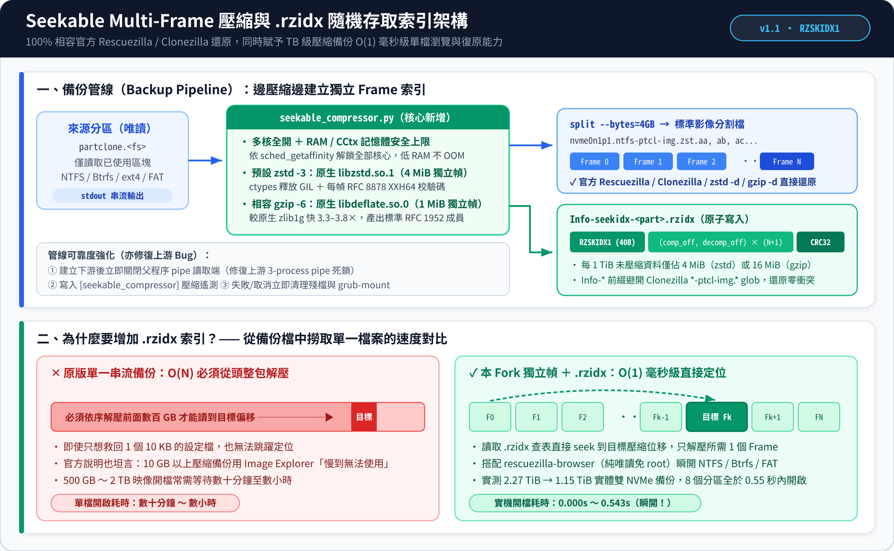
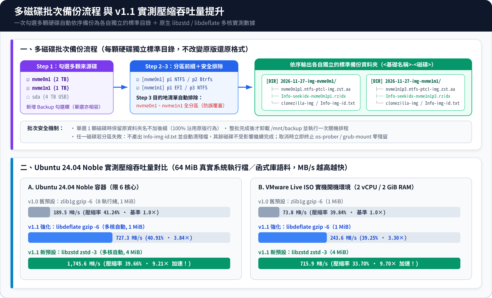
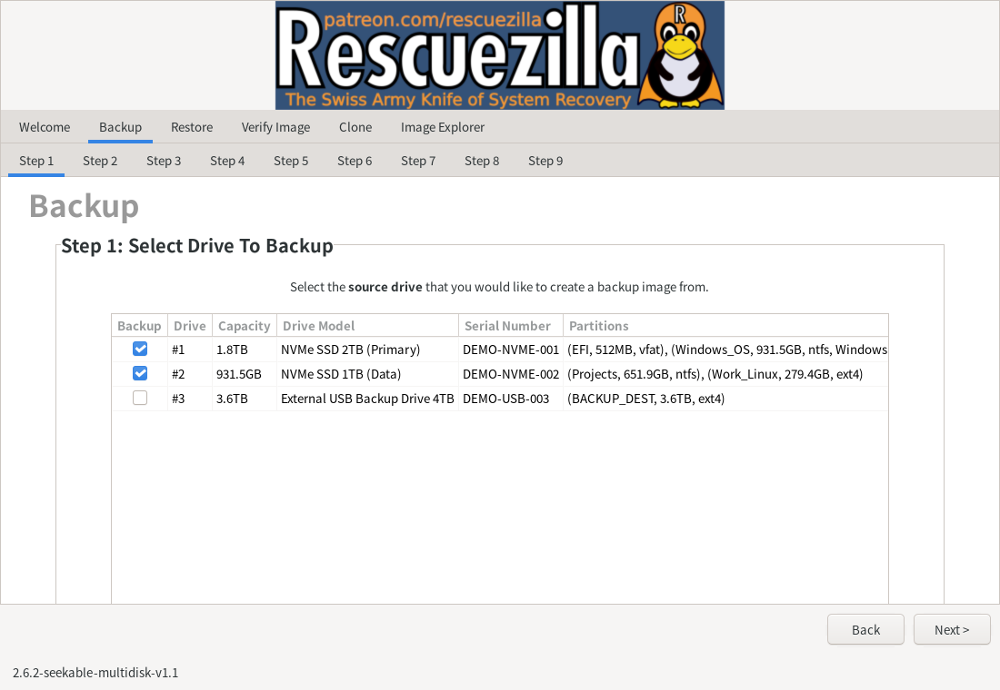
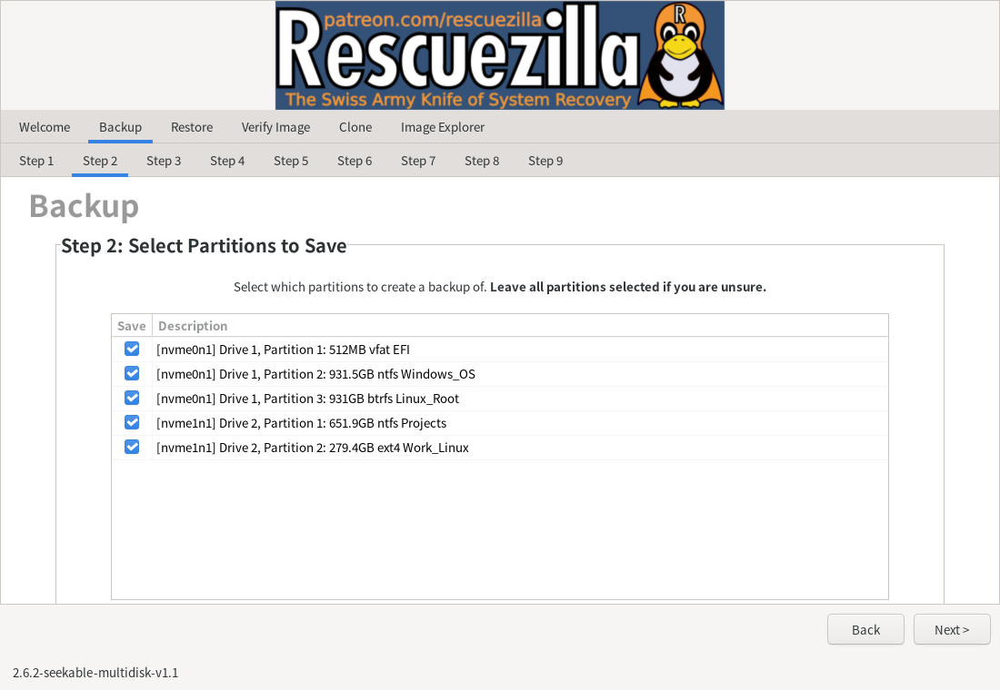
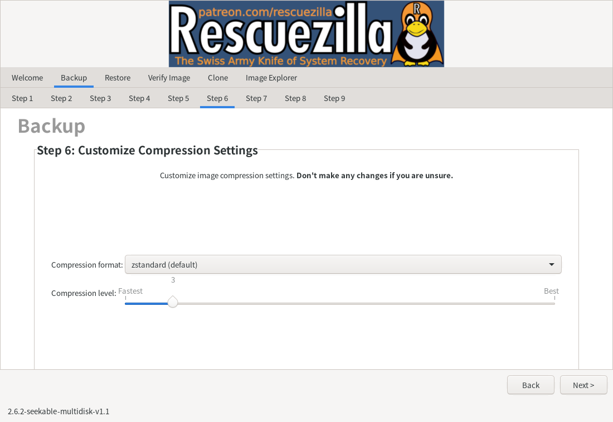
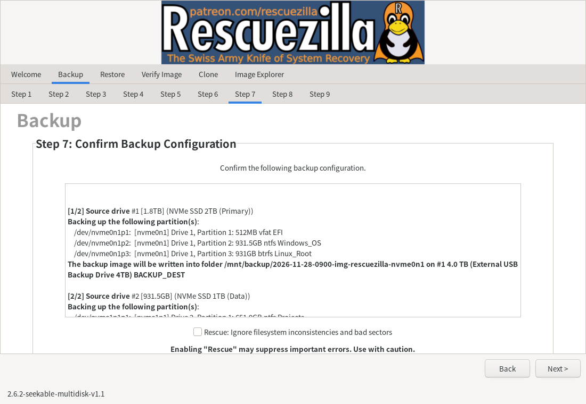
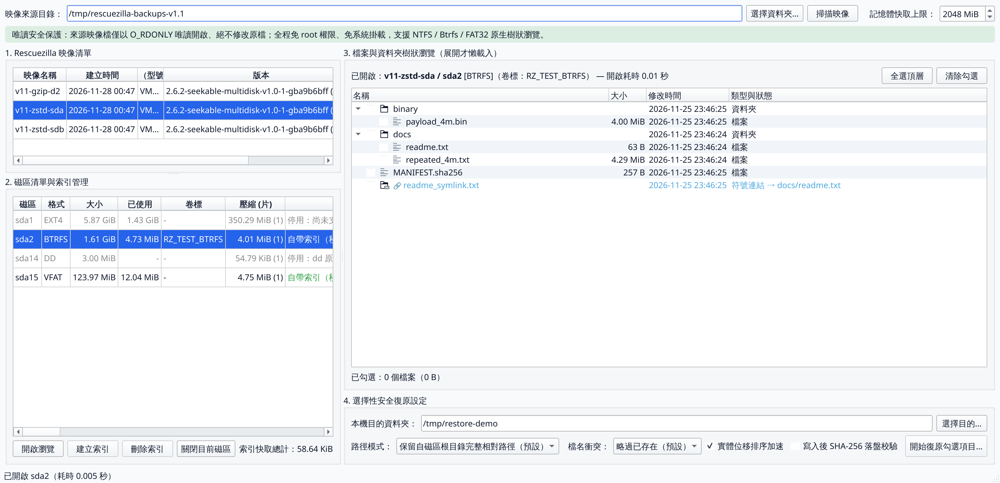

[](https://rescuezilla.com)

# SeekZilla（瞬尋救援龍）— Seekable Index, Multi-Disk & Hybrid Differential Backup (`v2.2`)

> **非官方衍生分支聲明（GPL-3.0-or-later）**：**SeekZilla** 為 [rescuezilla/rescuezilla](https://github.com/rescuezilla/rescuezilla) 的社群衍生分支（分支 `feature/seekable-index`，最新定版標籤 [`2.7.0-seekzilla-v2.2`](https://github.com/swho/rescuezilla/releases/tag/2.7.0-seekzilla-v2.2)），與官方 Rescuezilla 專案無隸屬或背書關係。所有修改與全新設計視覺素材均依 **GNU GPL v3.0 or later** 釋出，詳細修改紀錄與實測證據請見 [`FORK_NOTES.md`](FORK_NOTES.md)。

---

## SeekZilla 多做了什麼？（與官方原版 Rescuezilla 差異總覽）

官方 Rescuezilla 備份單顆硬碟與整碟還原非常穩定，但在處理 **TB 級系統定期備份**與**多顆 NVMe 同時備份**時有三個核心痛點：
1. **壓縮映像無法快速單檔還原**：傳統單一串流 `.gz` / `.zst` 必須從頭線性解壓數百 GB 才能讀到檔案，官方亦標註 10 GB 以上壓縮映像瀏覽「慢到無法使用」。
2. **一次只能備份一顆磁碟**：擁有多顆硬碟時，必須守在電腦前等第一顆備份數小時結束，再手動重走一次精靈流程。
3. **每次都得重新寫入數百 GB 完整備份**：日常僅異動少數檔案，卻沒有基準點差異備份機制。

**SeekZilla (`v2.2`)** 在 **完整備份（Base）維持 100% 官方 Rescuezilla / Clonezilla 還原格式相容** 的前提下，新增以下能力：

| 功能項目 | 官方原版 Rescuezilla | SeekZilla (`v2.2`) |
|---|---|---|
| **隨機存取索引（`.rzidx`）** | 無（需 `O(N)` 整包線性解壓，常耗時數十分鐘～數小時） | **備份時同步原子寫入 `Info-seekidx-<part>.rzidx`**，支援 `O(1)` 毫秒級定位單幀（實測 1.18 TiB 實體備份 **0.000s～0.543s** 瞬開） |
| **混合區塊級差異備份（`.rzbhash` + `rzdiff`）** | 無（每次皆需重寫整顆磁碟完整備份） | **Step 4 選完目的資料夾即自動掃描並選擇完整／差異備份**，即時預覽各分割區 `DIFF`／`FULL`／`NEEDS INDEX` 計畫（3 區變 4 區、改格式、磁碟名稱漂移均清楚標示）；差異備份僅儲存異動 1 MiB 區塊（Depth-1，**永不修改 Base**），支援直接整碟還原、`partclone.chkimg` 校驗、一鍵 `merge` 合併回原版獨立完整映像、以及免解壓瞬開單檔瀏覽 |
| **舊版完整備份一鍵補建索引** | 無 | **Live USB Step 4 內建「Build Base Index (.rzbhash)...」即時補建按鈕**（利用 `.rzidx` 多核心並行解壓、即時顯示進度/MB/s/ETA、可安全取消、對原檔嚴格唯讀），亦可於 `SeekZilla Browser` GUI 或 CLI `block_hash.py build-from-image` 離線補建，一口氣完成補建＋差異備份 |
| **多磁碟一次備份** | Step 1 僅能單選 1 顆硬碟 | **Step 1 新增 `Backup` 勾選欄**，可一次勾選多顆硬碟，依序輸出為各自獨立標準目錄 `<基礎名稱>-<磁碟>`（單選維持原名無後綴） |
| **壓縮引擎與預設格式** | 預設 `gzip -6`（`pigz`） | **預設 `zstd -3` 原生 `libzstd.so.1`（4 MiB 獨立幀 + XXH64）**；`gzip -6` 亦導入原生 **`libdeflate.so.0`（1 MiB 獨立幀）**，並依可用核心與 RAM/CCtx 自動解鎖全核心 |
| **開機與介面視覺識別／4K 顯示自適應** | Rescuezilla 傳統介面（4K 螢幕字體極小） | 全新 **SeekZilla** 深海藍（`#0F172A`）+ 電光青（`#38BDF8`）向量視覺（GRUB、Plymouth、桌布、GTK 橫幅、Openbox 自動最大化）；**4K / HiDPI 螢幕開機自動切換至易讀 1080p（或 `seekzilla_display=720p` / `native`）**，支援 16:10／21:9／32:9 原生比例、單模式 4K 面板 2× 縮放與 `efifb`/安全模式 DPI 備援，GRUB 亦優先 720p/1024×768/1080p |
| **格式相容性** | 標準 Clonezilla 映像 | **完整備份（Base）與 `merge` 合併後映像 100% 產出標準 RFC 8878 `.zst.*` / RFC 1952 `.gz.*` 分割檔**，官方 Rescuezilla / Clonezilla 可直接還原 |

> **相容性提醒**：
> - **完整備份（Base）**：與官方 Rescuezilla / Clonezilla 100% 相容（`Info-seekidx-*.rzidx` 與 `Info-bhash-*.rzbhash` 皆以 `Info-*` 命名避開原版還原 glob）。
> - **差異備份（`rzdiff`）**：與 Base 為配對關係（`README-RZDIFF.txt` 有完整說明），請保留同層目錄的 Base 映像勿更動；還原／校驗時全程 fail-closed 核對 Base 每塊 SHA-256（任何 1-bit 損毀即拒絕還原）。若需交給原版 Rescuezilla / Clonezilla 獨立使用，執行 `diff_synthesizer.py merge` 即可無損合併回獨立完整映像。
> - 官方內建舊版 Image Explorer 僅支援 `gzip` / `xz` / `uncompressed` 完整備份；瀏覽 `zstd` 與 `rzdiff` 差異備份請搭配 **`SeekZilla Browser`**（`rescuezilla-browser`），或於 Step 6 選用 `gzip` 完整備份。

---

## 圖解一：Seekable Multi-Frame 與 `.rzidx` 索引架構



- **邊壓縮邊建索引，零二次掃描**：[`seekable_compressor.py`](src/apps/rescuezilla/rescuezilla/usr/lib/python3/dist-packages/rescuezilla/seekable_compressor.py) 將 `partclone` 串流切分為獨立壓縮幀（`zstd` 預設 **4 MiB**、`gzip` 預設 **1 MiB**），以 `ctypes` 直接呼叫 Ubuntu 24.04 Noble 預裝的 `libzstd.so.1` 與 `libdeflate.so.0`（釋放 GIL、零子行程開銷），並將每幀的 `(comp_offset, decomp_offset)` 與尾端 IEEE CRC32 原子寫入 `Info-seekidx-<分區>.rzidx`。
- **極低空間開銷**：每 1 TiB 未壓縮資料僅需約 **4 MiB**（`zstd` 4 MiB 幀）或 **16 MiB**（`gzip` 1 MiB 幀）的索引檔。
- **隨時可關閉**：啟動前設定環境變數 `RESCUEZILLA_SEEKABLE_INDEX=0` 即可退回官方原版 `pigz` / `zstd` 串流模式。

---

## 圖解二：多磁碟批次備份流程 與 v1.1 實測吞吐量對比



### 實測驗證摘要（均為實機／容器量測數據）

| 驗證環境與項目 | 實測數據 |
|---|---|
| **Ubuntu 24.04 Noble（6 核容器，64 MiB 真實系統執行檔語料）** | 舊 `zlib1g gzip -6 (8t, 1M)`：`189.5 MB/s` (41.24%) → 新 `libdeflate gzip -6 (auto, 1M)`：**`727.3 MB/s` (3.84×, 40.91%)** → 新預設 `libzstd zstd -3 (auto, 4M)`：**`1,745.6 MB/s` (9.21×, 39.66%)** |
| **VMware Live ISO 實機（2 vCPU / 2 GiB RAM，64 MiB 語料）** | 舊 `zlib1g`：`73.8 MB/s` (39.84%) → 新 `libdeflate`：**`243.6 MB/s` (3.30×, 39.25%)** → 新預設 `libzstd 4M`：**`715.9 MB/s` (9.70×, 33.70%)** |
| **實體雙 NVMe 裸機多磁碟備份稽核（i9-13980HX，2.271 TiB → 1.153 TiB）** | 9 個分區全數 `Partclone exit code: 0`、`Info-img-id.txt` SHA-512 100% 吻合、抽樣解壓 496 個 frame（含全部 314 個跨 4 GB split 邊界幀）**0 錯誤**；全部 8 個可瀏覽分區透過 `.rzidx` 於 **0.000s～0.543s** 瞬開 |
| **自動化單元測試與 Live E2E (`v2.2`)** | Noble Docker 單元測試 **220 / 220 通過**（含 Step 4 整合流程、多核心 `.rzidx` 並行補建 `.rzbhash`、分區增減與漂移防護、57 項 4K 顯示自適應測試）+ 實機 GTK3 `1280×666` 零裁切視覺驗證 + `SeekZilla Browser` **217 / 217 通過**（`ruff` 0 錯誤）；VMware Live ISO 實機完成 FAT32 / Btrfs / NTFS Full Base → V2 異動 → 差異備份（大小僅為 Base 的 **8.8%**、Base 零異動）→ `VerifyManager` (`partclone.chkimg`) → 1-bit 基準損毀阻斷（exit `4`）→ `partclone.restore` V2 100% SHA-256 吻合 → `merge` 合併回原版完整映像 → `SeekZilla Browser` **0.002s～0.004s** 瞬開與 100% SHA-256 復原 |

---

## 實際操作畫面（Screenshots）

### 1. Step 1：一次勾選多顆來源硬碟（新增 `Backup` 勾選欄）
勾選多顆磁碟後，點「Next」即可一次串聯備份；若未勾選任何方塊，仍相容原版「反白單列直接下一步」操作，且在勾選欄雙擊不會誤觸二次翻轉。



### 2. Step 2：清楚標示 `[磁碟]` 前綴的全部分區清單
一次檢視所有已勾選硬碟的分區（自動加上 `[nvme0n1]`、`[nvme1n1]` 前綴），並於下一步 **Step 3 目的地清單中自動排除全部已選來源碟**，防止誤覆蓋來源磁碟。



### 3. Step 6：v1.1 全新預設 `zstandard (default)` 等級 3
開箱即預設採用 `zstandard` 等級 3（原生 `libzstd.so.1` + 4 MiB 獨立幀 + XXH64），兼顧最高壓縮速度與更小備份體積；需要舊版相容時亦可直接切換為 `gzip`（原生 `libdeflate.so.0`）。



### 4. Step 7：獨立 `<基礎名稱>-<磁碟>` 輸出路徑確認頁
逐一列出 `[1/2]`、`[2/2]` 每顆磁碟各自對應的獨立標準目錄，並在執行前檢查是否已有同名資料夾避免覆蓋。



### 5. 搭配 `.rzidx` 索引：免 root 唯讀毫秒級瞬開瀏覽與單檔還原
備份完成後，透過 `rescuezilla-browser`（純唯讀、免 root、免系統掛載）讀取 `Info-seekidx-*.rzidx`，畫面左下狀態列實測 **`已開啟 sda2（耗時 0.005 秒）`**，可直接勾選單一檔案或資料夾並執行落盤後 SHA-256 校驗復原：



---

## CLI 進階工具：多磁碟備份、補建 `.rzbhash` 與合併差異映像

### 1. 多磁碟批次備份
`rescuezillapy backup --source` 亦已擴充支援多顆磁碟，並於建立任何目錄前完成正規化、去重與 `--partitions` 預檢：

```bash
# 一次依序備份兩顆 NVMe 至各自獨立目錄：
#   /mnt/backup/2026-11-28-img-nvme0n1/
#   /mnt/backup/2026-11-28-img-nvme1n1/
sudo rescuezillapy backup \
  --source /dev/nvme0n1 \
  --source /dev/nvme1n1 \
  --destination /mnt/backup/2026-11-28-img \
  --compression-format zstd \
  --compression-level 3
```

### 2. 為既有完整備份離線補建 `.rzbhash` 差異基準索引（唯讀來源）
```bash
# 針對舊版 v1.0 / v1.1 完整備份的單一分區補建 Info-bhash-<part>.rzbhash：
python3 /usr/lib/python3/dist-packages/rescuezilla/block_hash.py build-from-image \
  --image-dir /mnt/backup/2026-11-27-img-nvme0n1 \
  --partition nvme0n1p1
```

### 3. 將差異備份合併為獨立的官方相容完整備份（`merge`）
```bash
python3 /usr/lib/python3/dist-packages/rescuezilla/diff_synthesizer.py merge \
  --diff-dir /mnt/backup/2026-11-28-diff-seekzilla-nvme0n1 \
  --output-dir /mnt/backup/2026-11-28-standalone-nvme0n1 \
  --format zstd --level 3
```

---

## 相關文件與授權（GPL-3.0-or-later）

- 完整修改明細、實測數據與 GPLv3 聲明：[`FORK_NOTES.md`](FORK_NOTES.md)
- 完整授權條款：[`LICENSE`](LICENSE)
- Live ISO 建置說明：[`docs/build_instructions/BUILD.ISO.IMAGE.md`](docs/build_instructions/BUILD.ISO.IMAGE.md)

---

# Upstream Rescuezilla Documentation

The following is the original upstream Rescuezilla README preserved for reference and attribution.

---

# Rescuezilla [](https://github.com/rescuezilla/rescuezilla/actions/workflows/build-rescuezilla-iso.yml) [](https://github.com/rescuezilla/rescuezilla/actions/workflows/run-integration-test-suite.yml) [](https://hosted.weblate.org/engage/rescuezilla/)

Rescuezilla is an easy-to-use disk cloning and imaging application that's fully compatible with Clonezilla — the industry-standard trusted by tens of millions.

Yes, Rescuezilla is the Clonezilla GUI (graphical user interface) that you might have been looking for. But Rescuezilla is more than a Clonezilla GUI!

Disk imaging is the process of making a backup of your computer's hard drive which is managed as files stored on an external hard drive, and 'disk cloning' is the process of making a direct copy without needing a third drive for temporary storage.

For many people, the alternative open-source tools such as Clonezilla are intimidating and difficult to use, so Rescuezilla provides an easy-to-use graphical environment like the leading commercial tools, Acronis True Image and Macrium Reflect.

It's worth noting that hard drive imaging and cloning is a very specialized task that's not necessarily the best solution for every user: it's worth researching whether a traditional file-based backup approach is more suitable for the specific problem you are looking to solve.

Rescuezilla can be booted on any PC or Mac from a USB stick, and has been carefully developed to be fully interoperable with the Clonezilla. This means Rescuezilla can restore backups created by Clonezilla, and backups created by Rescuezilla can be restored using Clonezilla!

Rescuezilla was forked from _Redo Backup and Recovery_ (now called Redo Rescue) because it had been abandoned for 7 years. Rescuezilla is more than a trivial fork: it has been carefully rebuilt from the ground up to be fully compatible with the industry-standard Clonezilla.

## Features

* Simple graphical environment anyone can use
* Creates backup images that are fully interoperable with the industry-standard Clonezilla
* Supports images made by all known open-source imaging frontends, including Clonezilla (see 'compatibility' section of download page)
* Also supports virtual machine images: VirtualBox (VDI), VMWare (VMDK), Hyper-V (VHDx), Qemu (QCOW2), raw (.dd, .img) and many more
* Access files from within images (including virtual machine images) using 'Image Explorer (beta)'
* Fully supports advanced environments such as Linux md RAID, LVM and no partition table (filesystem directly-on-disk)
* Supports cloning (for direct 'device-to-device' mode without needing a third drive for temporary storage)
* Boots from Live USB stick on any PC or Mac
* Full system backup, bare metal recovery, partition editing, data protection, web browsing, and more
* Extra tools for hard drive partitioning, factory reset, undeleting files
* Web browser for downloading drivers, reading documentation
* File explorer for copying and editing files even if system won't boot
* Based on Ubuntu and partclone

Note: Rescuezilla does NOT yet _automatically_ shrink partitions to restore to disks _smaller_ than original. This feature will be added in future version.

## Supported Languages

You can help translate Rescuezilla on [Hosted Weblate](https://hosted.weblate.org/engage/rescuezilla/).

[](https://hosted.weblate.org/engage/rescuezilla/)

## Upstream Screenshots

<a href="https://raw.githubusercontent.com/rescuezilla/rescuezilla.github.io/master/media/screenshots/2.png"></a>
<a href="https://raw.githubusercontent.com/rescuezilla/rescuezilla.github.io/master/media/screenshots/1.png"></a>
<a href="https://raw.githubusercontent.com/rescuezilla/rescuezilla.github.io/master/media/screenshots/4.png"></a>
<a href="https://raw.githubusercontent.com/rescuezilla/rescuezilla.github.io/master/media/screenshots/5.png"></a>
<a href="https://raw.githubusercontent.com/rescuezilla/rescuezilla.github.io/master/media/screenshots/6.png"></a>
<a href="https://raw.githubusercontent.com/rescuezilla/rescuezilla.github.io/master/media/screenshots/7.png"></a>
<a href="https://raw.githubusercontent.com/rescuezilla/rescuezilla.github.io/master/media/screenshots/3.png"></a>
<a href="https://raw.githubusercontent.com/rescuezilla/rescuezilla.github.io/master/media/screenshots/8.png"></a>
<a href="https://raw.githubusercontent.com/rescuezilla/rescuezilla.github.io/master/media/screenshots/9.png"></a>
<a href="https://raw.githubusercontent.com/rescuezilla/rescuezilla.github.io/master/media/screenshots/10.png"></a>

## History

Below table shows an abridged history of Rescuezilla. For more information, see the [CHANGELOG.md](https://github.com/rescuezilla/rescuezilla/blob/master/CHANGELOG.md) file.

| Release             | Release Date | Operating System | Notes |
| ------------------- | ---------- | ---------------- | ---------------------------------- |
| Rescuezilla Rolling | 2023-XX-XX | Ubuntu 24.04     | Periodic [rolling release](https://github.com/rescuezilla/rescuezilla/releases) with bleeding-edge features and translations
| Rescuezilla 2.5.1   | 2024-09-08 | Ubuntu 24.04     | Added command-line interface
| Rescuezilla 2.4.2   | 2023-03-05 | Ubuntu 22.04     | Began compiling latest partclone
| Rescuezilla 2.3.1   | 2022-01-02 | Ubuntu 21.10     | Added 'Verify Image'
| Rescuezilla 2.2     | 2021-06-04 | Ubuntu 21.04     | Added 'Clone', VM image support.
| Rescuezilla 2.1     | 2020-12-12 | Ubuntu 20.10     | Added Image Explorer (beta)
| Rescuezilla 2.0     | 2020-10-14 | Ubuntu 20.04     | Added Clonezilla image support
| Rescuezilla 1.0.6   | 2020-06-17 | Ubuntu 20.04     |
| Redo Rescue 2.0.0   | 2020-06-12 | Debian 9 Stretch | Redo author [resurfaces](https://sourceforge.net/p/redobackup/discussion/general/thread/d0e37c4750/) after 7.5 year absence
| Rescuezilla 1.0.5.1 | 2020-03-24 | Ubuntu 18.04.4   |
| Rescuezilla 1.0.5   | 2019-11-08 | Ubuntu 18.04.3   | Rescuezilla [fork](https://sourceforge.net/p/redobackup/discussion/general/thread/116063b485/?limit=25#610c) revives project
| Community updates   | Various    | Various          | Sporadic community [updates](https://github.com/rescuezilla/rescuezilla/wiki/Bugs-in-unofficial-Redo-Backup-updates#identifying-redo-backup-versions) for Redo
| Redo Backup 1.0.4   | 2012-11-20 | Ubuntu 12.04.1   | Last release by Redo author for 7.5 years
| Redo Backup 0.9.8   | 2011-03-10 | Ubuntu 10.10     | Redo author [deleted](https://sourceforge.net/p/redobackup/discussion/help/thread/4ea6ca31/) v0.9.2-v0.9.7
| Redo Backup 0.9.2   | 2010-06-24 | xPUD             |

## Reviews and testimonials

Please consider posting a review of Rescuezilla on the very useful website [AlternativeTo.Net](https://alternativeto.net/software/rescuezilla/reviews/). Consider giving the project a like too! :-)

## Building

See [Building ISO image](docs/build_instructions/BUILD.ISO.IMAGE.md)

## Future development

Rescuezilla features are prioritized according to the [roadmap](https://github.com/rescuezilla/rescuezilla/wiki/Rescuezilla-Project-Roadmap). Please consider becoming a [Patreon to help fund Rescuezilla's continued development](https://www.patreon.com/join/rescuezilla)!

## Support

If you need help, start by checking the [frequently asked questions](https://rescuezilla.com/help), then proceed to the [Rescuezilla forum](https://sourceforge.net/p/rescuezilla/discussion/).

## Upstream Downloads

[Download the latest official Rescuezilla ISO image on the upstream GitHub Release page](https://github.com/rescuezilla/rescuezilla/releases/latest)
